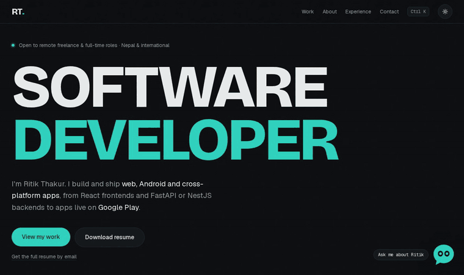

<p align="center">
  <a href="https://www.ritikthakur.com.np">
    
  </a>
</p>

<p align="center">
  <a href="https://www.ritikthakur.com.np"></a>
  <a href="https://github.com/ritikthakur22/portfolio/actions/workflows/ci.yml"></a>
</p>

<p align="center">
  
  
  
  
  
  
</p>

<p align="center">
  
  
  
  
</p>

My personal site. It shows the apps I've built and shipped, from a school ERP on Google Play to a peer-to-peer file sharing tool, and it has a small AI assistant that answers questions about my work.

<p align="center">
  
</p>

## What's on the site

- **Kinetic hero.** The headline assembles letter by letter, a soft glow follows the cursor and the buttons lean toward it.
- **Pinned project showcase.** Featured apps slide sideways as you scroll, with 3D tilt, a spotlight and a light beam around each card. On phones it becomes a simple vertical list.
- **Case-study pages** for each featured app, with screenshots, stack and links.
- **Stacking experience cards**, scroll-reactive text bands, hover previews for smaller projects, a cursor-reactive dot grid and live GitHub activity.
- **Chat assistant** in the corner: a draggable bubble whose eyes follow your cursor. It only answers questions about me and my projects, and politely declines anything else. Type `ritik` anywhere on the page to say hi to it.
- **Command palette** on `Ctrl K` or `/` to jump anywhere, switch theme, copy my email or download my resume.
- **Light and dark themes** with a circular reveal, following your system setting by default.
- **Contact form** that sends through my own domain, with a backup sender, spam protection and an automatic reply.
- **Resume on request.** The public PDF leaves out my phone number; anyone can have the full version emailed to them in one step.
- **A 404 page** with an eye that keeps looking for the page you wanted.

Every animation respects the reduced-motion setting, and all content is readable without JavaScript.

## Built with

| Area | Tools |
| --- | --- |
| Framework | Next.js 16 (App Router, Cache Components), React 19, TypeScript |
| Styling | Tailwind CSS 4, Bricolage Grotesque, Geist and Geist Mono |
| Motion | GSAP with ScrollTrigger and SplitText, Lenis smooth scrolling, View Transitions |
| AI assistant | Vercel AI SDK with Groq, Gemini and OpenRouter in a fallback chain, plus Llama Prompt Guard |
| Email | Resend from my domain, Gmail SMTP as backup, Cloudflare Turnstile |
| Quality | Vitest, Playwright, axe-core, Lighthouse CI on GitHub Actions |
| Hosting | Vercel with Cloudflare DNS |

Everything runs on free tiers.

## Run it locally

You need Node.js 22 or newer.

```bash
git clone https://github.com/ritikthakur22/portfolio.git
cd portfolio
npm install
cp .env.example .env   # then fill in the keys you have
npm run dev
```

Open http://localhost:3000. The site works without any keys: the assistant shows a friendly fallback, the form asks visitors to email me directly and the GitHub section stays hidden.

| Command | What it does |
| --- | --- |
| `npm run dev` | Start the dev server |
| `npm run build` then `npm start` | Production build and server |
| `npm run lint`, `npm run typecheck` | Code checks |
| `npm test` | Unit tests |
| `npm run e2e` | Browser tests, including accessibility |
| `LIVE=1 npx vitest run tests/live` | Checks the real AI and email providers (uses your keys) |

## Environment variables

| Variable | Used for |
| --- | --- |
| `GROQ_API_KEY`, `GROQ_MODEL`, `GROQ_MODEL_2` | Main assistant models and the prompt guard |
| `GEMINI_API_KEY`, `GEMINI_MODEL` | Second assistant fallback |
| `OPENROUTER_API_KEY`, `OPENROUTER_MODEL` | Last assistant fallback |
| `RESEND_API_KEY` | Sends contact emails from contact@ritikthakur.com.np |
| `EMAIL_USER`, `EMAIL_APP_PASSWORD` | Gmail backup sender (an app password, not your login) |
| `CONTACT_TO` | Inbox that receives contact messages |
| `NEXT_PUBLIC_TURNSTILE_SITE_KEY`, `TURNSTILE_SECRET_KEY` | Spam check on the contact and resume forms |
| `GITHUB_TOKEN` | Read-only token for the GitHub activity section |
| `RESUME_FULL_URL` | Private direct-download link to the full resume, emailed on request (falls back to the public copy) |

Keys live in `.env` locally and in the Vercel project settings in production. They are never committed.

## Where things are

```
content/      All text on the site: profile, experience, skills, projects
app/          Pages, case studies, API routes, SEO files
components/   Sections, animation pieces, chat, command palette
lib/          Email, chat rules, rate limiting, GitHub data, SEO helpers
tests/        Unit, browser and live checks
public/       Resume, photo and project screenshots
```

To update the site, edit the files in `content/`. The pages, the assistant, the structured data for search engines and `llms.txt` all read from there.

## Deploying

Pushes to `main` deploy to Vercel automatically. Add the environment variables in Vercel before the first deploy, then redeploy whenever you change them. Variables starting with `NEXT_PUBLIC_` are built into the page, so after changing one, redeploy with **Use existing Build Cache** turned off. Mark secret keys as **Sensitive** in Vercel.

## License

All rights reserved. The code is public so you can see how it works; please don't reuse the design or content as your own portfolio.
